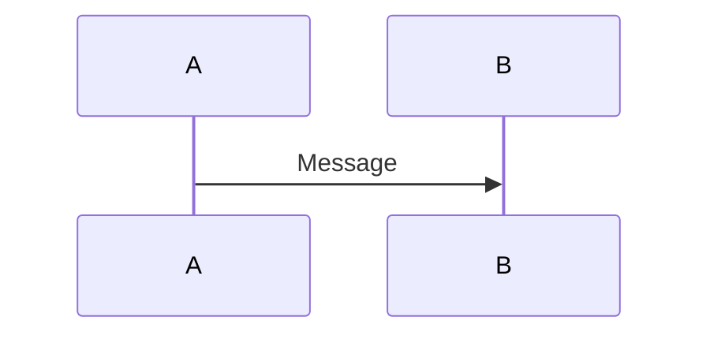
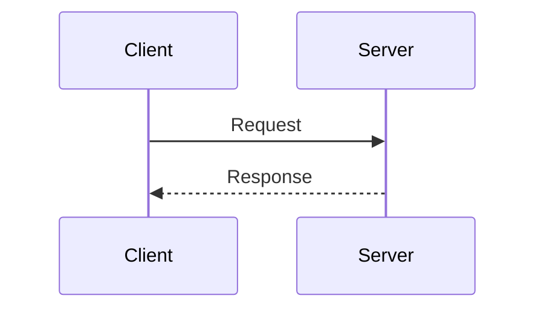

# Mermaid 시퀀스 문법 · 선별 발췌

`softaworks/agent-toolkit`의 기본 참여자와 동기 요청/응답 문법만 발췌했다. 전체 스킬·도구·외부 편집기 안내는 가져오지 않았다. 아래는 문법 예시이며 실제 과제의 아키텍처가 아니다. 실제 노드와 호출은 코드에서 확인해 바꾼다.

출처: https://github.com/softaworks/agent-toolkit/blob/3027f20f3181758385a1bb8c022d4041dfb4de84/skills/mermaid-diagrams/references/sequence-diagrams.md

Copyright (c) 2026 Leonardo Flores. MIT License. 전체 고지: [THIRD_PARTY_NOTICES](../../../../THIRD_PARTY_NOTICES.md).

기존 로컬 렌더러가 있으면 구문을 확인한다. 없으면 문법/표 대조까지만 수행했다고 적는다. 시험 코드·데이터·그림을 외부 렌더링 서비스에 전송하지 않는다.
