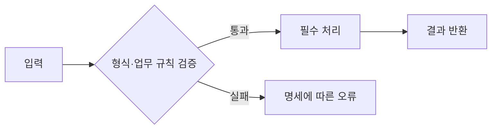

# 필요한 다이어그램만 선택하기

| 알고 싶은 것 | 적절한 그림 | 넣을 내용 |
| --- | --- | --- |
| 입력부터 결과까지 어디서 판단하는가 | flowchart | 입력 검증, 주요 처리, 실패 분기, 결과 |
| 누가 어떤 순서로 호출하고 상태를 바꾸는가 | sequenceDiagram | 실제 참여자, 호출, 반환, 실패/재시도 분기 |
| 여러 데이터가 어떤 관계를 갖는가 | erDiagram | 실제 데이터 개체, 식별자, 관계·다중성 |
| 상태 전이를 잘못 허용할 수 있는가 | stateDiagram-v2 | 상태, 전이 조건, 차단 조건 |

단순한 함수 수정에 ERD·배포 구성을 의무적으로 추가하지 않는다. 새로운 서비스나 DB는 원문에서 필요하거나 설계 이유가 있을 때만 등장시킨다.

작성 규칙:
- 노드 ID는 짧은 ASCII, 화면 라벨은 따옴표로 감싼다. 요구사항 ID를 라벨이나 바로 아래 설명에 연결한다.
- 성공 경로와 관련 실패 경로를 구분한다. 아직 정하지 못한 정책은 그림 밖 가정/미정 목록에 연결한다.
- 기존 구조는 코드에서 확인한 참여자만 넣는다. 제안 그림에는 ‘제안 설계 · 미구현’이라고 표시한다.
- 원본 코드가 바뀌면 그림과 파일 책임 표도 함께 갱신한다.

설계 추적 표: 요구 ID | 변경할 파일·함수/컴포넌트 | 입력 검증·실패 정책 | 검증 입력·기대 결과 | 구현/계획 상태.

Mermaid 예시는 실제 과제가 아닌 구조 설명용이다:

‘검증’에 해당하는 R-ID와 구체적인 규칙을 실제 과제에 맞게 써야 설계가 된다. 이 일반 그림을 그대로 제출물의 완성 설계로 취급하지 않는다.
